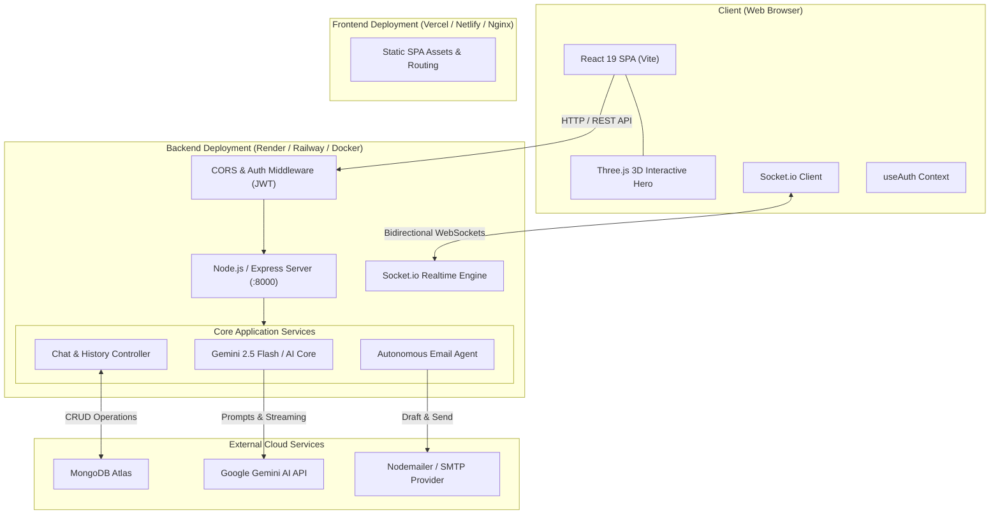

# 🌌 Nexora - Next-Gen AI Workspace & Interactive Agent Hub

Nexora is an intelligent workspace featuring real-time AI-powered conversations, autonomous email drafting agents, real-time WebSockets, and an interactive 3D landing page built with Three.js.

The system is decoupled into a high-performance **Node.js/Express API Backend** and a reactive **Vite + React SPA Frontend**, designed for easy independent deployment.

---

## 🏗️ System Architecture



---

## ✨ Features

- **Decoupled Architecture**: Modular `Frontend/` and `Backend/` workspaces for independent scalability and continuous deployment.
- **Three.js 3D Hero Canvas**: Interactive mouse-tracking particle field with smooth wave mechanics on the landing page.
- **Dynamic AI Assistance**: Integrated with Google Gemini Flash for real-time conversational intelligence.
- **Agentic Capabilities**: Autonomous email drafting and task processing via background service workers.
- **Real-Time Communication**: WebSocket channels powered by Socket.io for instantaneous message dispatching.
- **Secure Authentication**: JWT token authentication with bcrypt password hashing and persistent sessions.

---

## 📁 Repository Structure

```text
Nexora/
├── Backend/                 # Node.js + Express API server
│   ├── src/
│   │   ├── config/          # Database & environment configurations
│   │   ├── controllers/     # Route business logic (auth, chat, etc.)
│   │   ├── models/          # Mongoose DB schemas
│   │   ├── routes/          # Express route declarations
│   │   ├── services/        # Gemini AI, Mail & Agent services
│   │   └── sockets/         # Socket.io connection handlers
│   ├── server.js            # Backend entry point
│   ├── Dockerfile           # Backend containerization
│   └── .env.example         # Template for environment secrets
│
├── Frontend/                # Vite + React 19 Client SPA
│   ├── src/
│   │   ├── components/      # Shared components (NexoraLogo, ThreeHeroCanvas)
│   │   ├── features/        # Feature modules (auth, chat, dashboard)
│   │   └── index.css        # Global theme and typography
│   ├── nginx.conf           # Production Nginx reverse proxy configuration
│   ├── Dockerfile           # Multi-stage production container build
│   └── .env.example         # Frontend environment template
│
├── docker-compose.yml       # Unified container orchestration
└── README.md                # Documentation & Deployment Guides
```

---

## 🚀 Local Development Setup

### Prerequisites
- Node.js (v18 or higher)
- npm or yarn
- MongoDB connection string (local or MongoDB Atlas)
- Google Gemini API key

### 1. Backend Setup
```bash
cd Backend
npm install
cp .env.example .env
```
Fill out `.env` with your credentials:
```env
PORT=8000
MONGODB_URI=your_mongodb_connection_string
JWT_SECRET=your_jwt_secret_key
GEMINI_API_KEY=your_gemini_api_key
CLIENT_URL=http://localhost:5173
```
Start the backend server:
```bash
npm run dev
# Server running at http://localhost:8000
```

### 2. Frontend Setup
```bash
cd Frontend
npm install
cp .env.example .env
```
Ensure `.env` points to your backend:
```env
VITE_API_URL=http://localhost:8000
```
Start the frontend development server:
```bash
npm run dev
# Frontend running at http://localhost:5173
```

---

## 🐳 Docker Deployment (Full Stack)

You can run the complete stack including MongoDB with Docker Compose:

```bash
docker-compose up --build -d
```
- **Frontend**: Accessible at `http://localhost:80`
- **Backend API**: Accessible at `http://localhost:8000`
- **MongoDB**: Running at `mongodb://localhost:27017`

---

## 🌐 Separate Production Deployment Guide

### A. Deploying Frontend (Vercel / Netlify / Cloudflare Pages)

1. **Framework Preset**: Vite
2. **Root Directory**: `Frontend`
3. **Build Command**: `npm run build`
4. **Output Directory**: `dist`
5. **Environment Variables**:
   - `VITE_API_URL`: URL of your deployed Backend (e.g. `https://api.yourdomain.com` or `https://nexora-backend.onrender.com`)

### B. Deploying Backend (Render / Railway / VPS)

1. **Root Directory**: `Backend`
2. **Build Command**: `npm install`
3. **Start Command**: `node server.js`
4. **Environment Variables**:
   - `PORT`: `8000` (or dynamic port provided by host)
   - `MONGODB_URI`: Production MongoDB Atlas URI
   - `JWT_SECRET`: High-entropy secret string
   - `GEMINI_API_KEY`: Google AI Studio API Key
   - `CLIENT_URL`: URL of your deployed Frontend; this origin is allowed for both the REST API and Socket.IO (e.g. `https://nexora.vercel.app`)
   - `VITE_API_URL` (Frontend): URL of your deployed Backend (e.g. `https://nexora-backend-48xn.onrender.com`)

   For separate HTTPS frontend and backend deployments, set `CLIENT_URL` to the frontend's exact origin and `VITE_API_URL` to the backend URL. The API sets its authentication cookie as `SameSite=None; Secure` over HTTPS so browsers send it with cross-site requests. After deploying this change, sign in again so the browser receives a new cookie.

---

## 🔒 License
Distributed under the MIT License.
